# OVHcloud AI Endpoints — Guia Completo em Português 🇧🇷🇵🇹

> **Como a OVH fornece modelos LLM e endpoints, e como utilizá-los — da conta ao código de produção, cobrindo TODOS os tipos de uso.**
>
> Pesquisa consolidada em **08/10/2026** a partir de:
> Página oficial AI Endpoints, Catálogo de modelos (20 modelos), Documentação OVHcloud (Getting Started, Capabilities, Batch, Function Calling, Responses API, Audio, Virtual Models, Catalog API), LiteLLM, Hugging Face Inference Providers, LlamaIndex, Continue/OpenCode/Kilo.
>
> URLs canônicas:
> - Produto: `https://www.ovhcloud.com/en/public-cloud/ai-endpoints/`
> - Catálogo: `https://www.ovhcloud.com/en/public-cloud/ai-endpoints/catalog/`
> - API unificada (OpenAI-compatível): `https://oai.endpoints.kepler.ai.cloud.ovh.net/v1`
> - API de catálogo: `https://catalog.endpoints.ai.ovh.net/rest/v1/models_v2`
> - Docs: `https://docs.ovhcloud.com/en/guides/public-cloud/ai-machine-learning/ai-endpoints-getting-started`
> - Roadmap: `https://github.com/orgs/ovh/projects/16/views/1?sliceBy%5Bvalue%5D=AI+Endpoints`

---

## Índice

1. [PARTE 0 — O que a OVH entrega (visão executiva)](#parte-0--o-que-a-ovh-entrega-visão-executiva)
2. [PARTE 1 — Mapa diagramático de etapas (comece por aqui)](#parte-1--mapa-diagramático-de-etapas-comece-por-aqui)
3. [PARTE 2 — Etapas 0–4: fundação (conta → chave → catálogo → playground → billing)](#parte-2--etapas-04-fundação-conta--chave--catálogo--playground--billing)
4. [PARTE 3 — Matriz completa de tipos de uso (18 usos)](#parte-3--matriz-completa-de-tipos-de-uso-18-usos)
5. [PARTE 4 — Etapas por tipo de uso, com explicação + código](#parte-4--etapas-por-tipo-de-uso-com-explicação--código)
   - [Uso 1 — LLM Chat / Geração de texto](#uso-1--llm-chat--geração-de-texto-chat-completions)
   - [Uso 2 — Reasoning LLM (raciocínio)](#uso-2--reasoning-llm-raciocínio-matemática-código-tarefas-complexas)
   - [Uso 3 — Visual LLM (imagem + texto, OCR)](#uso-3--visual-llm-imagem--texto-ocr-análise-de-documentos)
   - [Uso 4 — Code LLM no IDE (Continue, Copilot, OpenCode, Kilo, SHAI)](#uso-4--code-llm-no-ide-assistente-privado-de-código)
   - [Uso 5 — Embeddings](#uso-5--embeddings-vetores-para-busca-semântica)
   - [Uso 6 — RAG completo (chatbot com seus documentos)](#uso-6--rag-completo-chatbot-com-seus-documentos)
   - [Uso 7 — Function Calling / Tool Calling / Agentes](#uso-7--function-calling--tool-calling--agentes)
   - [Uso 8 — Structured Outputs (JSON Mode + JSON Schema)](#uso-8--structured-outputs-json-mode--json-schema)
   - [Uso 9 — Streaming (respostas em tempo real)](#uso-9--streaming-respostas-token-a-token-sse)
   - [Uso 10 — Responses API (`/v1/responses`)](#uso-10--responses-api-v1responses-a-rota-mais-moderna)
   - [Uso 11 — Virtual Models (DSL `tag@ranker?condição`)](#uso-11--virtual-models-dsl-tagatk_rankercondição)
   - [Uso 12 — Speech-to-Text (Whisper, diarização, tradução)](#uso-12--speech-to-text-whisper-diarização-tradução-legendas)
   - [Uso 13 — Text-to-Speech (NVIDIA Riva)](#uso-13--text-to-speech-nvidia-riva)
   - [Uso 14 — Geração de imagens (Stable Diffusion XL)](#uso-14--geração-de-imagens-stable-diffusion-xl)
   - [Uso 15 — Moderação / LLM Guard (Qwen3Guard)](#uso-15--moderação--llm-guard-qwen3guard)
   - [Uso 16 — Batch API (processamento em massa, −50%)](#uso-16--batch-api-processamento-em-massa--50-beta)
   - [Uso 17 — Catalog API (descoberta programática de modelos)](#uso-17--catalog-api-descoberta-programática-de-modelos)
   - [Uso 18 — Integrações com frameworks e plataformas](#uso-18--integrações-com-frameworks-e-plataformas)
6. [PARTE 5 — Limites, preços, SLA, segurança e ciclo de vida](#parte-5--limites-preços-sla-segurança-e-ciclo-de-vida)
7. [PARTE 6 — Árvore de decisão: qual modelo / rota / modo usar?](#parte-6--árvore-de-decisão-qual-modelo--rota--modo-usar)
8. [PARTE 7 — Troubleshooting (erros comuns)](#parte-7--troubleshooting-erros-comuns)
9. [PARTE 8 — Produtos irmãos (quando NÃO usar AI Endpoints)](#parte-8--produtos-irmãos-quando-não-usar-ai-endpoints)
10. [Anexos — Exemplos executáveis neste repositório](#anexos--exemplos-executáveis-neste-repositório)

Documentos complementares:

- [`CATALOGO-MODELOS.md`](CATALOGO-MODELOS.md) — os 20 modelos do catálogo, com preço, licença, contexto e capacidades.
- [`CHEAT-SHEET.md`](CHEAT-SHEET.md) — 1 página: URLs, headers, rotas e snippets de emergência.
- [`exemplos/`](../exemplos) — código pronto em Python, JavaScript e cURL.

---

## PARTE 0 — O que a OVH entrega (visão executiva)

### 0.1. A oferta em 1 parágrafo

A OVHcloud fornece **AI Endpoints**: uma plataforma **serverless** de inferência de IA generativa. Você **não provisiona GPU, não faz deploy de modelo, não gerencia escala**: escolhe um dos **20+ modelos open-weight pré-treinados** no catálogo, obtém uma **API key** vinculada ao seu projeto Public Cloud e chama **uma única API compatível com OpenAI** (`/v1/*`). A cobrança é **pay-as-you-go por token** (ou por segundo de áudio / por imagem), e tudo roda em **infraestrutura OVHcloud na União Europeia** (Gravelines, França), com **zero retenção de dados** além do necessário para faturamento.

### 0.2. Os 8 blocos da oferta

```
┌─────────────────────────────────────────────────────────────────────┐
│                    OVHcloud AI ENDPOINTS                             │
│              (serverless · 1 API · 20+ modelos)                      │
├──────────────┬──────────────┬──────────────┬────────────────────────┤
│ 1. CATÁLOGO  │ 2. API       │ 3. MODOS     │ 4. ACESSO              │
│ 8 categorias │ OpenAI-      │ Base (tempo  │ Anônimo (teste,        │
│ LLM, Racioc. │ compatível   │ real) +      │ 2 req/min) ou          │
│ Visual, Code │ /v1/*        │ Batch (−50%, │ API key (400 req/min)  │
│ Emb., STT,   │              │ async 24h)   │ por projeto            │
├──────────────┼──────────────┼──────────────┼────────────────────────┤
│ 5. PLAY-     │ 6. VIRTUAL   │ 7. ECOS-     │ 8. GARANTIAS           │
│ GROUND       │ MODELS (DSL) │ SISTEMA      │ EU soberano · ISO      │
│ teste grátis │ tag@ranker?  │ LiteLLM, HF, │ 27001 · SOC2 · HDS     │
│ no browser + │ condição     │ LangChain,   │ SLA 99,98% (Base) ·    │
│ API explorer │ auto-seleção │ Continue…    │ zero data retention    │
└──────────────┴──────────────┴──────────────┴────────────────────────┘
```

### 0.3. As 8 categorias de modelo (o que cada uma resolve)

| # | Categoria no catálogo | O que é | Exemplo de modelo | Cobra por |
|---|---|---|---|---|
| 1 | **Large Language Models (LLM)** | Chat, resumo, tradução, classificação, sentimento | `Meta-Llama-3_3-70B-Instruct` | token in/out |
| 2 | **Reasoning LLM** | Raciocina antes de responder (matemática, código, lógica) | `gpt-oss-120b`, `gpt-oss-20b` | token in/out |
| 3 | **Visual LLM** | Entende **imagem + texto** (descrição, OCR, documentos, VQA) | `Qwen3.8-27B`, `Qwen2.5-VL-72B-Instruct` | token in/out |
| 4 | **Embeddings** | Texto → vetor (busca semântica, RAG, clustering) | `bge-m3`, `Qwen3-Embedding-8B` | token in |
| 5 | **Speech To Text** | Áudio → texto (transcrição, diarização, tradução) | `whisper-large-v3-turbo` | segundo de áudio |
| 6 | **Text To Speech** | Texto → fala (EN, DE, ES, IT) | `nvr-tts-en-us` | grátis* |
| 7 | **Image Generation** | Texto → imagem | `stable-diffusion-xl-base-v10` | grátis* |
| 8 | **LLM Guard** | Moderação de conteúdo (segurança) | `Qwen3Guard-Gen-8B` | grátis* (beta) |

> *Preços do catálogo em 10/2026 — ver [`CATALOGO-MODELOS.md`](CATALOGO-MODELOS.md) e a página de preços. "Grátis" = €0 no catálogo atual.

### 0.4. Arquitetura lógica (onde cada peça mora)

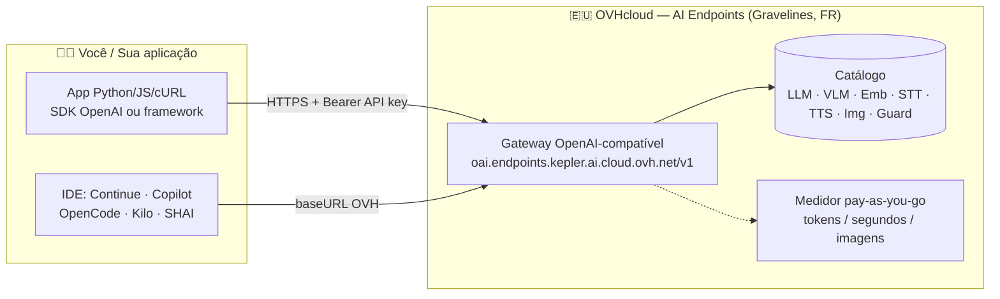

**Reversibilidade:** como a API segue o padrão OpenAI, você pode trocar de provedor (ou auto-hospedar) **sem reescrever código** — basta trocar `base_url` + `api_key` + `model`.

---

## PARTE 1 — Mapa diagramático de etapas (comece por aqui)

### Diagrama-mestre: do zero à produção

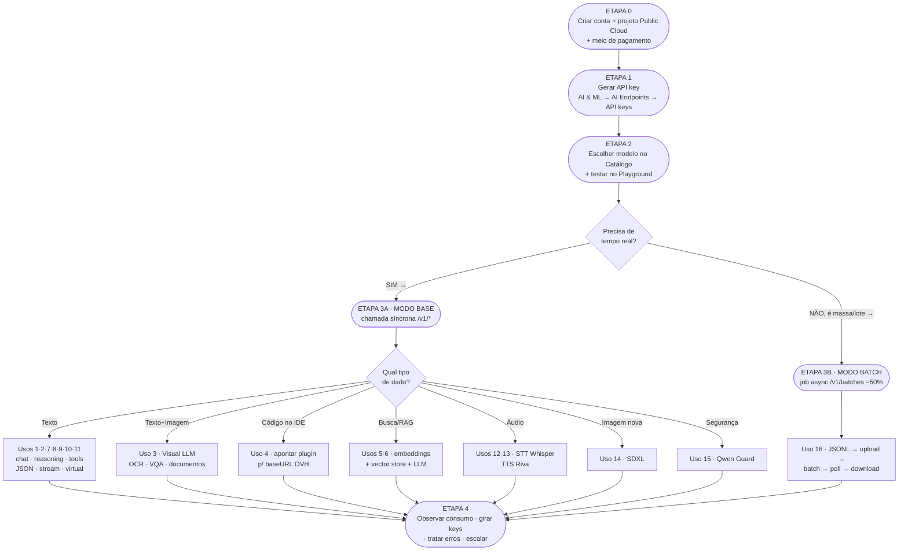

### Mesmo mapa em ASCII (para terminal / leitura rápida)

```
ETAPA 0 ──► ETAPA 1 ──► ETAPA 2 ──► DECISÃO ──┬──► ETAPA 3A (BASE, tempo real) ──┬──► ETAPA 4
  conta       API key     catálogo   tempo     │    /v1/chat · /v1/embed ·       │    monitorar
  +projeto    + .env      +play-     real?     │    /v1/audio · /v1/images       │    + billing
  +pagamento              ground      │        │                                │    + lifecycle
                                      │        └──► ETAPA 3B (BATCH, async ─50%)┘
                                      │             /v1/files + /v1/batches
                                      ▼
                              + ETAPAS TRANSVERSAIS: streaming · tools · JSON · virtual models ·
                                responses API · catalog API · integrações (Uso 9,10,11,17,18)
```

### Tabela de etapas resumida (o que → onde → código neste guia)

| Etapa | Objetivo | Onde fazer | Seção do guia |
|---|---|---|---|
| **0** | Conta + projeto Public Cloud + pagamento | Manager OVHcloud | [2.1](#21-etapa-0--conta-projeto-e-pagamento-5-min) |
| **1** | Gerar e guardar API key | AI & ML → AI Endpoints → API keys | [2.2](#22-etapa-1--gerar-e-guardar-a-api-key-3-min) |
| **2** | Escolher modelo + testar grátis | Catálogo + Playground | [2.3](#23-etapa-2--escolher-o-modelo-e-testar-no-playground-10-min) |
| **3A** | Chamar API síncrona (Base) | `POST /v1/*` com Bearer | [Usos 1–15](#uso-1--llm-chat--geração-de-texto-chat-completions) |
| **3B** | Chamar API assíncrona em massa (Batch) | `POST /v1/files` + `/v1/batches` | [Uso 16](#uso-16--batch-api-processamento-em-massa--50-beta) |
| **4** | Produção: billing, limites, ciclo de vida | Control Panel + código resiliente | [Parte 5](#parte-5--limites-preços-sla-segurança-e-ciclo-de-vida) |

---

## PARTE 2 — Etapas 0–4: fundação (conta → chave → catálogo → playground → billing)

### 2.1. ETAPA 0 — Conta, projeto e pagamento (~5 min)

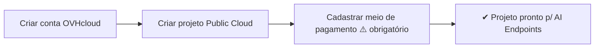

**Explicação.** AI Endpoints é cobrado no **projeto Public Cloud**. Projetos em modo *Discovery* (sem pagamento) **não conseguem usar o serviço com chave** — só resta o acesso anônimo limitado. A OVH oferece **US$ 200 em crédito grátis** para novos projetos Public Cloud ("Get started now" na página do produto).

**Passos:**

1. Crie a conta em `ovhcloud.com` e entre no **Manager** (`ovh.com/manager`).
2. Crie/selecione um **Public Cloud project**.
3. Cadastre um **meio de pagamento** no projeto.
4. No menu lateral: **`AI & Machine Learning` → `AI Endpoints`**.

### 2.2. ETAPA 1 — Gerar e guardar a API key (~3 min)

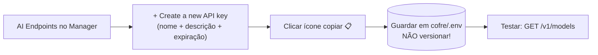

**Explicação.** A key é vinculada ao **projeto** (não à pessoa). Você pode ter várias keys (por time/ambiente) com **validade ajustável**. O valor aparece **uma única vez** — se perder, crie outra. Para revogar: mesma tela → `...` → `Delete`.

> ⚠️ **Projetos compartilhados (limitação IAM atual):** com compartilhamento NIC clássico, membros criam keys que o admin **não vê nem revoga** (só removendo o acesso). Com IAM novo, membros **não criam** sem permissão de admin. Peça ao admin.

**Código — configurar e testar a key:**

```bash
# 1) Exporte a key (nunca cole no código!)
export OVH_AI_ENDPOINTS_ACCESS_TOKEN="sua-key-aqui"

# 2) Teste: listar modelos acessíveis (OpenAI-compatível)
curl https://oai.endpoints.kepler.ai.cloud.ovh.net/v1/models \
  -H "Authorization: Bearer $OVH_AI_ENDPOINTS_ACCESS_TOKEN"
```

```python
# Python — teste mínimo (pip install openai)
import os
from openai import OpenAI

client = OpenAI(
    base_url="https://oai.endpoints.kepler.ai.cloud.ovh.net/v1",
    api_key=os.environ["OVH_AI_ENDPOINTS_ACCESS_TOKEN"],
)
print([m.id for m in client.models.list().data])
```

> **Sem key (modo anônimo):** funciona para testes rápidos (omitindo `api_key` ou string vazia), mas limitado a **2 req/min por IP e por modelo**. Batch API **exige** key.

### 2.3. ETAPA 2 — Escolher o modelo e testar no Playground (~10 min)

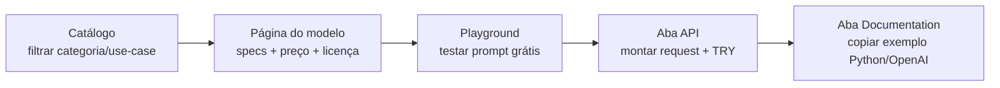

**Explicação.** Cada modelo tem página própria com **4 abas**: `Playground` (chat de teste — LLMs limitados a **1024 tokens de saída** no playground), `API` (monta request, mostra **cURL gerado** + resposta — ótimo para aprender o schema), `Documentation` (exemplo Python pronto) e `Tutorials` (guias: chatbot, tradutor de vídeo, RAG…).

**Como escolher (atalho):**

| Seu caso | Filtro no catálogo | Candidatos (10/2026) |
|---|---|---|
| Chat geral barato | LLM + `text_generation` | `gpt-oss-20b` (€0.04/0.15), `Qwen3.5-9B` (€0.10/0.15) |
| Raciocínio forte | Reasoning LLM | `gpt-oss-120b` (€0.08/0.40) |
| Imagem + texto | Visual LLM + `vision` | `Qwen3.8-27B`, `Qwen3.6-27B` (€0.40/2.70, 262K ctx) |
| Código | `code_chat` / `code_completion` | `Qwen3.8-27B`, `Qwen3.6-27B` |
| Busca semântica/RAG | Embeddings | `bge-m3` (€0.01/Mtok), `Qwen3-Embedding-8B` (€0.10/Mtok) |
| Transcrever áudio | Speech To Text | `whisper-large-v3-turbo` (mais barato/rápido) |
| Falar (TTS) | Text To Speech | `nvr-tts-en-us/de-de/es-es/it-it` (grátis) |
| Criar imagem | Image Generation | `stable-diffusion-xl-base-v10` (grátis) |
| Moderar conteúdo | LLM Guard (beta) | `Qwen3Guard-Gen-8B/0.6B` (grátis) |

Ver tabela completa com os 20 modelos em [`CATALOGO-MODELOS.md`](CATALOGO-MODELOS.md).

### 2.4. ETAPA 4 (antecipada) — Onde ver consumo e fatura

No Manager: **`AI & Machine Learning` → `AI Endpoints`** mostra **nº de chamadas por modelo, tokens in/out, estimativa de consumo**. Detalhes de preços: página de preços (`public-cloud/prices/#ai-endpoints`) + doc *Billing and lifecycle*. Uso 16 explica como **cortar 50%** com Batch.

---

## PARTE 3 — Matriz completa de tipos de uso (18 usos)

> **Garantia de completude:** cada linha abaixo tem seção própria na Parte 4 com **diagrama de micro-etapas + explicação + código Python/JS/cURL**. Nada do catálogo, das docs ou da página oficial ficou de fora.

| Uso | Nome | Rota(s) | Modelo(s) típicos | Quando usar |
|---|---|---|---|---|
| **1** | LLM Chat / geração de texto | `POST /v1/chat/completions` | `Meta-Llama-3_3-70B`, `gpt-oss-20b` | chatbots, resumo, tradução, classificação |
| **2** | Reasoning LLM | `POST /v1/chat/completions` (+ `reasoning_effort`) | `gpt-oss-120b/20b`, `Qwen3.*` | matemática, lógica, código complexo |
| **3** | Visual LLM (VLM) | `POST /v1/chat/completions` (com `image_url`) | `Qwen3.8-27B`, `Qwen2.5-VL-72B` | OCR, documentos, VQA, acessibilidade |
| **4** | Code LLM no IDE | baseURL OVH no plugin | `Qwen3.8-27B` + Continue/Copilot | autocomplete, chat de código privado |
| **5** | Embeddings | `POST /v1/embeddings` | `bge-m3`, `Qwen3-Embedding-8B` | busca semântica, clustering, RAG-base |
| **6** | RAG completo | embeddings + vector store + LLM | `bge-m3` + `Mistral/Llama` | chatbot sobre seus PDFs/docs |
| **7** | Function/Tool Calling | `POST /v1/chat/completions` (+ `tools`) | modelos com `function_calling` | agentes, assistentes que agem |
| **8** | Structured Outputs | `response_format: json_object/json_schema` | idem | extração tipada, APIs determinísticas |
| **9** | Streaming | `stream:true` (SSE) | qualquer LLM | UX em tempo real (digitando…) |
| **10** | Responses API | `POST /v1/responses` | `gpt-oss-20b`, VLM… | API moderna: estado, tools, visão |
| **11** | Virtual Models (DSL) | `model: "tag@ranker?cond"` | resolvido p/ catálogo | à prova de futuro, otimizar custo |
| **12** | Speech-to-Text | `POST /v1/audio/transcriptions` | `whisper-large-v3(-turbo)` | transcrição, diarização, legendas |
| **13** | Text-to-Speech | endpoint Riva / catálogo | `nvr-tts-*` | narração, acessibilidade, IVR |
| **14** | Geração de imagens | endpoint SDXL / catálogo | `stable-diffusion-xl-base-v10` | thumbnails, mockups, assets |
| **15** | Moderação (LLM Guard) | endpoint Guard (beta) | `Qwen3Guard-Gen-*` | filtrar entrada/saída |
| **16** | Batch API | `/v1/files` + `/v1/batches` | LLMs + embeddings (MVP) | massa/offline com −50% |
| **17** | Catalog API | `GET catalog…/models_v2` | — (metadados) | descoberta dinâmica, roteamento |
| **18** | Integrações | SDKs/frameworks | todos | LangChain, LlamaIndex, LiteLLM, HF… |

**Mapa mental dos usos (mermaid):**

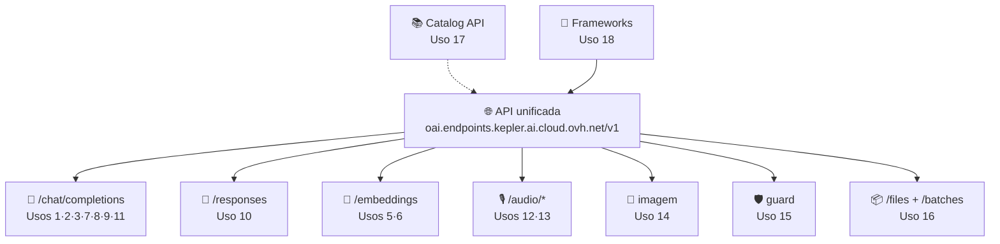

---

## PARTE 4 — Etapas por tipo de uso, com explicação + código

> **Convenção de código:** todos os exemplos assumem `export OVH_AI_ENDPOINTS_ACCESS_TOKEN="..."`.
> `BASE=https://oai.endpoints.kepler.ai.cloud.ovh.net/v1`. Python usa `pip install openai`; JS usa `npm install openai`.

---

### Uso 1 — LLM Chat / geração de texto (`chat/completions`)

**Micro-etapas:**

```mermaid
flowchart LR
    A[Montar messages<br/>system+user] --> B["POST /v1/chat/completions<br/>model + temperature + max_tokens"]
    B --> C[Ler choices[0].message.content]
    C --> D[Manter history p/ multi-turno]
```

**Explicação.** É o uso fundamental: você envia uma lista de mensagens (`system` = instruções, `user`/`assistant` = conversa) e recebe a continuação. Parâmetros-chave: `temperature` (0 = determinístico, >0 = criativo), `max_tokens` (teto da resposta), `seed` (reprodutibilidade), `top_p`. Para conversas, **reenvie o histórico** a cada turno (a API é stateless).

**Código — Python:**

```python
import os
from openai import OpenAI

client = OpenAI(
    base_url="https://oai.endpoints.kepler.ai.cloud.ovh.net/v1",
    api_key=os.environ["OVH_AI_ENDPOINTS_ACCESS_TOKEN"],
)

resp = client.chat.completions.create(
    model="Meta-Llama-3_3-70B-Instruct",   # ou "gpt-oss-20b" (mais barato)
    messages=[
        {"role": "system", "content": "Você é um assistente prestativo que responde em português."},
        {"role": "user", "content": "Resuma em 2 frases: o que é a OVHcloud AI Endpoints?"},
    ],
    temperature=0.2,
    max_tokens=300,
    seed=42,
)
print(resp.choices[0].message.content)
print("tokens:", resp.usage.prompt_tokens, "+", resp.usage.completion_tokens)
```

**Código — JavaScript:**

```javascript
import OpenAI from "openai";

const client = new OpenAI({
  baseURL: "https://oai.endpoints.kepler.ai.cloud.ovh.net/v1",
  apiKey: process.env.OVH_AI_ENDPOINTS_ACCESS_TOKEN,
});

const resp = await client.chat.completions.create({
  model: "Meta-Llama-3_3-70B-Instruct",
  messages: [
    { role: "system", content: "Você é um assistente prestativo que responde em português." },
    { role: "user", content: "Resuma em 2 frases: o que é a OVHcloud AI Endpoints?" },
  ],
  temperature: 0.2,
  max_tokens: 300,
});
console.log(resp.choices[0].message.content);
```

**Código — cURL:**

```bash
curl https://oai.endpoints.kepler.ai.cloud.ovh.net/v1/chat/completions \
  -H "Content-Type: application/json" \
  -H "Authorization: Bearer $OVH_AI_ENDPOINTS_ACCESS_TOKEN" \
  -d '{
    "model": "Meta-Llama-3_3-70B-Instruct",
    "messages": [
      {"role": "system", "content": "Você é um assistente prestativo que responde em português."},
      {"role": "user", "content": "Resuma em 2 frases: o que é a OVHcloud AI Endpoints?"}
    ],
    "temperature": 0.2,
    "max_tokens": 300
  }'
```

**Variações do mesmo padrão:** resumo (`"Resuma o texto: ..."`), tradução, análise de sentimento, classificação, paráfrase, extração de entidades — muda só o `system`/`user`. Ver filtros de use-case no catálogo.

📄 Executável: [`exemplos/python/01_chat.py`](../exemplos/python/01_chat.py) · [`exemplos/javascript/01_chat.mjs`](../exemplos/javascript/01_chat.mjs) · [`exemplos/curl/01_chat.sh`](../exemplos/curl/01_chat.sh)

---

### Uso 2 — Reasoning LLM (raciocínio: matemática, código, tarefas complexas)

**Micro-etapas:**

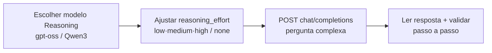

**Explicação.** Modelos *reasoning* geram um raciocínio interno antes da resposta final — melhores em matemática, código e planejamento. No catálogo têm a tag `Reasoning` (`gpt-oss-120b/20b`, família `Qwen3.*`). Você pode controlar o esforço com o parâmetro **`reasoning_effort`** (nos exemplos oficiais: `"none"` desliga; caso contrário o modelo decide). Contexto: gpt-oss = 131K; Qwen3 = 262K.

**Código — Python (raciocínio + esforço controlado):**

```python
import os
from openai import OpenAI

client = OpenAI(
    base_url="https://oai.endpoints.kepler.ai.cloud.ovh.net/v1",
    api_key=os.environ["OVH_AI_ENDPOINTS_ACCESS_TOKEN"],
)

# Modelo barato p/ raciocínio leve; troque p/ gpt-oss-120b se precisar de força máxima
resp = client.chat.completions.create(
    model="gpt-oss-20b",
    messages=[
        {"role": "system", "content": "Resolva passo a passo e dê a resposta final destacada."},
        {"role": "user", "content": "Uma loja vendeu 240 itens em 3 dias, cada dia 20% a mais que o anterior. Quantos vendeu no 1º dia?"},
    ],
    temperature=0,
    max_tokens=1024,
)
print(resp.choices[0].message.content)
```

**Código — cURL (com `reasoning_effort` explícito):**

```bash
curl https://oai.endpoints.kepler.ai.cloud.ovh.net/v1/chat/completions \
  -H "Content-Type: application/json" \
  -H "Authorization: Bearer $OVH_AI_ENDPOINTS_ACCESS_TOKEN" \
  -d '{
    "model": "gpt-oss-120b",
    "messages": [{"role": "user", "content": "Explique como funciona quicksort e dê a complexidade média.", "reasoning_effort": "medium"}],
    "max_tokens": 1024,
    "temperature": 0
  }'
```

> Dica de custo: `gpt-oss-20b` (€0.04/0.15 por Mtok) resolve 80% dos casos; suba para `gpt-oss-120b` ou `Qwen3.5-397B` só no que for realmente difícil.

---

### Uso 3 — Visual LLM (imagem + texto: OCR, análise de documentos)

**Micro-etapas:**

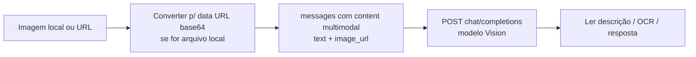

**Explicação.** Modelos com tag `Vision` aceitam **texto + imagem** na mesma mensagem. Limite de payload para VLM: **10 MB** (maior que os 2 MB padrão). Casos: descrever imagem, ler documento (OCR), responder pergunta sobre gráfico, acessibilidade (alt-text). Modelos: `Qwen3.8-27B`, `Qwen3.6-27B`, `Qwen3.5-397B/9B` (todos 262K ctx, function calling + reasoning) e `Qwen2.5-VL-72B-Instruct` (32K).

**Código — Python (arquivo local → base64):**

```python
import base64, mimetypes, os
from openai import OpenAI

client = OpenAI(
    base_url="https://oai.endpoints.kepler.ai.cloud.ovh.net/v1",
    api_key=os.environ["OVH_AI_ENDPOINTS_ACCESS_TOKEN"],
)

def to_data_url(path: str) -> str:
    mime, _ = mimetypes.guess_type(path)
    with open(path, "rb") as f:
        b64 = base64.b64encode(f.read()).decode()
    return f"data:{mime or 'image/jpeg'};base64,{b64}"

resp = client.chat.completions.create(
    model="Qwen3.8-27B",   # Vision + Reasoning + Function calling, 262K ctx
    messages=[{
        "role": "user",
        "content": [
            {"type": "text", "text": "Transcreva todo o texto visível nesta imagem (OCR) e resuma em 1 frase."},
            {"type": "image_url", "image_url": {"url": to_data_url("nota_fiscal.jpg")}},
        ],
    }],
    max_tokens=1024,
)
print(resp.choices[0].message.content)
```

**Código — JavaScript (imagem por URL pública):**

```javascript
import OpenAI from "openai";
const client = new OpenAI({
  baseURL: "https://oai.endpoints.kepler.ai.cloud.ovh.net/v1",
  apiKey: process.env.OVH_AI_ENDPOINTS_ACCESS_TOKEN,
});

const resp = await client.chat.completions.create({
  model: "Qwen3.6-27B",
  messages: [{
    role: "user",
    content: [
      { type: "text", text: "O que há nesta imagem? Responda em português." },
      { type: "image_url", image_url: { url: "https://exemplo.com/foto.jpg" } },
    ],
  }],
  max_tokens: 500,
});
console.log(resp.choices[0].message.content);
```

📄 Executável: [`exemplos/python/03_vision.py`](../exemplos/python/03_vision.py)

---

### Uso 4 — Code LLM no IDE (assistente privado de código)

**Micro-etapas (iguais para Continue, Copilot Chat, OpenCode, Kilo, SHAI):**

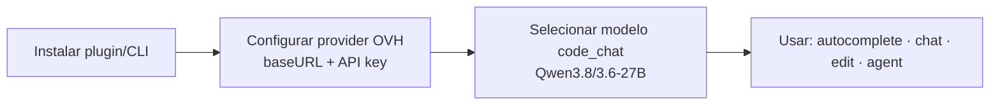

**Explicação.** Como a API é OpenAI-compatível, qualquer assistente de código que aceite "custom provider / baseURL" funciona com a OVH — e seu código **não sai da UE nem treina modelos**. É o caso de uso "Private code assistant" da página oficial.

**4a. Continue (VS Code / JetBrains)** — `~/.continue/config.yaml`:

```yaml
models:
  - name: OVH Qwen3.8-27B
    provider: openai
    model: Qwen3.8-27B
    apiKey: ${{ secrets.OVH_AI_ENDPOINTS_ACCESS_TOKEN }}
    apiBase: https://oai.endpoints.kepler.ai.cloud.ovh.net/v1
tabAutocompleteModel:
  title: OVH autocomplete
  provider: openai
  model: Qwen3.6-27B
  apiKey: ${{ secrets.OVH_AI_ENDPOINTS_ACCESS_TOKEN }}
  apiBase: https://oai.endpoints.kepler.ai.cloud.ovh.net/v1
```

Docs: `docs.continue.dev/customize/model-providers/more/ovhcloud`.

**4b. GitHub Copilot Chat (extensão `ovhcloud-ai-endpoints-copilot`):**

1. Gerar a key no Manager (Uso anônimo NÃO suportado aqui).
2. `Ctrl+Shift+P` → *OVHcloud AI Endpoints: Set API token* (vai para o cofre do VS Code).
3. `Test connection and list models` → escolher modelos no picker do Copilot Chat.
4. Config padrão: `ovhAiEndpoints.baseUrl = https://oai.endpoints.kepler.ai.cloud.ovh.net/v1`.

**4c. OpenCode (terminal):** `/connect` → buscar **OVHcloud AI Endpoints** → colar key → `/models` → escolher `gpt-oss-120b` ou Qwen.

**4d. Kilo Code / Kilo CLI, SHAI (Shell AI da OVH), Mastra:** mesmo padrão — provider `ovhcloud`, `baseURL` acima, key via env. Links na [Parte 4 · Uso 18](#uso-18--integrações-com-frameworks-e-plataformas).

---

### Uso 5 — Embeddings (vetores para busca semântica)

**Micro-etapas:**

```mermaid
flowchart LR
    A[Lista de textos 1–25] --> B[POST /v1/embeddings<br/>model bge-m3…]
    B --> C[Vetores float[] por texto]
    C --> D[Salvar em vector store<br/>ou comparar cosseno]
```

**Explicação.** Embeddings transformam texto em vetores densos para **busca por significado** (não por palavra). No modo Base, cada chamada aceita **1–25 textos**. Modelos: `bge-m3` (multilíngue, 100+ idiomas, denso+sparse, €0.01/Mtok), `bge-multilingual-gemma2` e `Qwen3-Embedding-8B` (maior qualidade, €0.10/Mtok).

**Código — Python:**

```python
import os
from openai import OpenAI

client = OpenAI(
    base_url="https://oai.endpoints.kepler.ai.cloud.ovh.net/v1",
    api_key=os.environ["OVH_AI_ENDPOINTS_ACCESS_TOKEN"],
)

texts = ["Gosto de futebol.", "O tempo está bom hoje.", "Receita de bolo de chocolate."]
emb = client.embeddings.create(model="bge-m3", input=texts)
print("dimensões:", len(emb.data[0].embedding))
# emb.data[i].embedding -> list[float]; guarde num vector store (Chroma, pgvector, Qdrant…)
```

**Código — cURL:**

```bash
curl https://oai.endpoints.kepler.ai.cloud.ovh.net/v1/embeddings \
  -H "Content-Type: application/json" \
  -H "Authorization: Bearer $OVH_AI_ENDPOINTS_ACCESS_TOKEN" \
  -d '{"model": "bge-m3", "input": ["Gosto de futebol.", "O tempo está bom hoje."]}'
```

📄 Executável: [`exemplos/python/05_embeddings.py`](../exemplos/python/05_embeddings.py)

---

### Uso 6 — RAG completo (chatbot com seus documentos)

**Micro-etapas (indexação → consulta):**

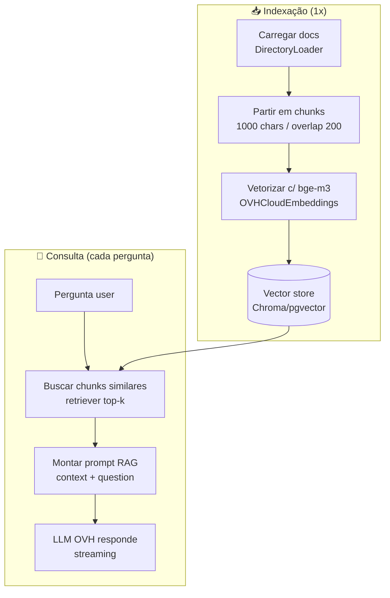

**Explicação.** RAG = **Retrieval-Augmented Generation**: em vez de o LLM "chutar", ele responde **com base nos seus documentos**. O guia oficial usa **LangChain + Chroma + OVH** (`ChatMistralAI` apontado para o endpoint OVH + `OVHCloudEmbeddings`). Abaixo, versão com SDK OpenAI direto + Chroma (menos dependências) e a fiel ao guia oficial.

**Código — Python (LangChain, fiel ao guia oficial):**

```python
# pip install langchain langchain-community langchain-mistralai chromadb
import argparse, os, time
from langchain_community.document_loaders import DirectoryLoader
from langchain_text_splitters import RecursiveCharacterTextSplitter
from langchain_community.vectorstores import Chroma
from langchain_community.embeddings.ovhcloud import OVHCloudEmbeddings
from langchain_mistralai import ChatMistralAI
from langchain import hub
from langchain_core.runnables import RunnablePassthrough

TOKEN = os.environ["OVH_AI_ENDPOINTS_ACCESS_TOKEN"]
URL = "https://oai.endpoints.kepler.ai.cloud.ovh.net/v1"

def chat_completion(question: str):
    model = ChatMistralAI(
        model="Meta-Llama-3_3-70B-Instruct",
        api_key=TOKEN, endpoint=URL, max_tokens=1500, streaming=True,
    )
    docs = DirectoryLoader(glob="**/*", path="./rag-files/", show_progress=True).load()
    splits = RecursiveCharacterTextSplitter(chunk_size=1000, chunk_overlap=200).split_documents(docs)
    store = Chroma.from_documents(
        documents=splits,
        embedding=OVHCloudEmbeddings(model_name="bge-m3", access_token=TOKEN),
    )
    prompt = hub.pull("rlm/rag-prompt")
    chain = ({"context": store.as_retriever(), "question": RunnablePassthrough()} | prompt | model)
    print("🤖: ", end="")
    for r in chain.stream(question):
        print(r.content, end="", flush=True)
        time.sleep(0.02)
    print()

if __name__ == "__main__":
    p = argparse.ArgumentParser()
    p.add_argument("--question", default="O que dizem meus documentos sobre reembolso?")
    chat_completion(p.parse_args().question)
```

Guia oficial: *AI Endpoints - Build a RAG Chatbot with LangChain*. Variações: memória de chatbot (guia *chatbot-memory-langchain*), sumarizador de áudio (RAG sobre transcrições — combina Usos 6+12).

---

### Uso 7 — Function Calling / Tool Calling / Agentes

**Micro-etapas (loop agente):**

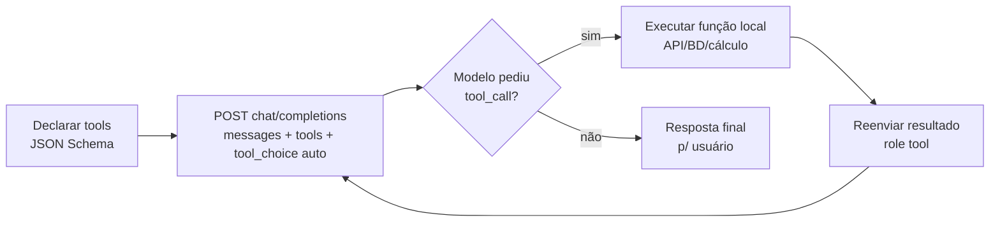

**Explicação.** *Function calling* deixa o LLM **chamar funções suas** (consultar API, banco, calendário…). O fluxo: (1) declare as tools em JSON Schema; (2) chame o modelo com `tools`; (3) se vier `tool_calls`, execute localmente; (4) devolva com `role: "tool"`; (5) repita até a resposta final. Use modelos com tag `Function calling` (Qwen3.*, gpt-oss-*, Llama-3.3-70B, Mistral-Nemo…). `tool_choice: "auto"` = modelo decide; `"required"` = força chamada.

**Código — Python (assistente time-tracking, adaptado do guia oficial):**

```python
import json, os
from openai import OpenAI

client = OpenAI(
    base_url="https://oai.endpoints.kepler.ai.cloud.ovh.net/v1",
    api_key=os.environ["OVH_AI_ENDPOINTS_ACCESS_TOKEN"],
)
MODEL = "Meta-Llama-3_3-70B-Instruct"  # tem Function calling

TOOLS = [
    {"type": "function", "function": {
        "name": "get_current_weather",
        "description": "Obtém o clima atual de uma cidade.",
        "parameters": {"type": "object", "properties": {
            "location": {"type": "string", "description": "A cidade"},
            "country": {"type": "string", "description": "Código do país, 2 letras"},
            "unit": {"type": "string", "enum": ["celsius", "fahrenheit"]},
        }, "required": ["location", "country"]}}},
]

def get_current_weather(location, country, unit="celsius"):
    return json.dumps({"location": location, "country": country, "temp": 21, "unit": unit})

messages = [{"role": "user", "content": "Como está o clima em Paris?"}]
resp = client.chat.completions.create(model=MODEL, messages=messages, tools=TOOLS,
                                      tool_choice="auto", temperature=0.15)
msg = resp.choices[0].message
messages.append(msg)

for call in (msg.tool_calls or []):
    args = json.loads(call.function.arguments)
    result = get_current_weather(**args)
    messages.append({"role": "tool", "tool_call_id": call.id, "content": result})

final = client.chat.completions.create(model=MODEL, messages=messages, temperature=0.15)
print(final.choices[0].message.content)
```

**Código — cURL (com streaming de tool calls):**

```bash
curl -X POST https://oai.endpoints.kepler.ai.cloud.ovh.net/v1/chat/completions \
  -H 'accept: application/json' -H 'Content-Type: application/json' \
  -H "Authorization: Bearer $OVH_AI_ENDPOINTS_ACCESS_TOKEN" \
  -d '{
    "model": "Meta-Llama-3_3-70B-Instruct",
    "messages": [{"role": "user", "content": "Como está o clima em Paris?"}],
    "tools": [{"type": "function", "function": {
      "name": "get_current_weather", "description": "Clima atual de uma cidade",
      "parameters": {"type": "object", "properties": {
        "location": {"type": "string"}, "country": {"type": "string"},
        "unit": {"type": "string", "enum": ["celsius", "fahrenheit"]}},
        "required": ["location", "country"]}}}],
    "tool_choice": "auto", "stream": true, "temperature": 0.1, "max_tokens": 200
  }'
```

📄 Executável: [`exemplos/python/07_tools.py`](../exemplos/python/07_tools.py)

---

### Uso 8 — Structured Outputs (JSON Mode + JSON Schema)

**Micro-etapas:**

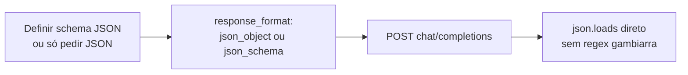

**Explicação.** Dois níveis: (1) **JSON Mode** (`{"type": "json_object"}`) garante JSON válido; (2) **Structured Outputs** (`{"type": "json_schema", ...}`) **impõe seu schema** (propriedades, tipos, obrigatórios). Ideal para extração de entidades, classificação tipada e integração com APIs.

**Código — Python (schema estrito):**

```python
import json, os
from openai import OpenAI

client = OpenAI(
    base_url="https://oai.endpoints.kepler.ai.cloud.ovh.net/v1",
    api_key=os.environ["OVH_AI_ENDPOINTS_ACCESS_TOKEN"],
)

resp = client.chat.completions.create(
    model="Meta-Llama-3_3-70B-Instruct",
    messages=[
        {"role": "system", "content": "Extraia dados estruturados do texto."},
        {"role": "user", "content": "A sala 12 contém livros, uma mesa e uma luminária."},
    ],
    response_format={
        "type": "json_schema",
        "json_schema": {
            "name": "data_extraction",
            "strict": False,
            "schema": {
                "type": "object",
                "properties": {
                    "section": {"type": "string"},
                    "products": {"type": "array", "items": {"type": "string"}},
                },
                "required": ["section", "products"],
                "additionalProperties": False,
            },
        },
    },
)
print(json.loads(resp.choices[0].message.content))
# {'section': 'sala 12', 'products': ['livros', 'mesa', 'luminária']}
```

**JSON Mode simples (qualquer modelo):** `response_format={"type": "json_object"}` + instrução "responda em JSON".

---

### Uso 9 — Streaming (respostas token-a-token, SSE)

**Micro-etapas:**

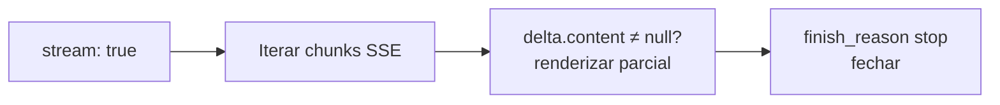

**Explicação.** Com `stream: true`, a API retorna **Server-Sent Events**: cada token chega num `data: {...}` até `data: [DONE]`. Essencial para chatbots (sensação de "digitando") e respostas longas. Funciona com chat, tools e Responses API. **Não suportado** em Whisper (STT).

**Código — Python:**

```python
import os
from openai import OpenAI

client = OpenAI(
    base_url="https://oai.endpoints.kepler.ai.cloud.ovh.net/v1",
    api_key=os.environ["OVH_AI_ENDPOINTS_ACCESS_TOKEN"],
)

stream = client.chat.completions.create(
    model="gpt-oss-20b",
    messages=[{"role": "user", "content": "Conte uma história curta sobre um robô."}],
    stream=True, max_tokens=500,
)
for chunk in stream:
    delta = chunk.choices[0].delta.content or ""
    print(delta, end="", flush=True)
print()
```

**Código — JavaScript:**

```javascript
import OpenAI from "openai";
const client = new OpenAI({
  baseURL: "https://oai.endpoints.kepler.ai.cloud.ovh.net/v1",
  apiKey: process.env.OVH_AI_ENDPOINTS_ACCESS_TOKEN,
});

const stream = await client.chat.completions.create({
  model: "gpt-oss-20b",
  messages: [{ role: "user", content: "Conte uma história curta sobre um robô." }],
  stream: true, max_tokens: 500,
});
for await (const chunk of stream) {
  process.stdout.write(chunk.choices[0]?.delta?.content || "");
}
```

📄 Executável: [`exemplos/python/09_stream.py`](../exemplos/python/09_stream.py)

---

### Uso 10 — Responses API (`/v1/responses`, a rota mais moderna)

**Micro-etapas:**

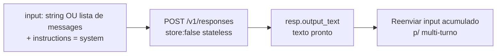

**Explicação.** A **Responses API** é a rota OpenAI mais recente, também suportada pela OVH. Diferenças para `/chat/completions`: usa **`input`** (string ou lista tipada) em vez de `messages`, **`instructions`** em vez de system, e retorna **`output_text`** pronto. Suporta **multi-turno, tools, structured outputs e visão** — inclusive com imagens (`input_text` + `input_image`). `store: false` = stateless (recomendado; a OVH não retém dados).

**Código — Python (multi-turno + system):**

```python
import os
from openai import OpenAI

client = OpenAI(
    base_url="https://oai.endpoints.kepler.ai.cloud.ovh.net/v1",
    api_key=os.environ["OVH_AI_ENDPOINTS_ACCESS_TOKEN"],
)

resp = client.responses.create(
    model="gpt-oss-20b",
    instructions="Você é um redator técnico. Responda em português.",
    store=False,
    input=[
        {"type": "message", "role": "user", "content": "Meu nome é Stéphane."},
        {"type": "message", "role": "assistant", "content": "Olá, Stéphane! Como posso ajudar?"},
        {"type": "message", "role": "user", "content": "Qual é o meu nome?"},
    ],
)
print(resp.output_text)
```

**Código — Python (visão via Responses API):**

```python
import base64, mimetypes
# ... mesmo client ...

def to_data_url(p):
    mime, _ = mimetypes.guess_type(p)
    with open(p, "rb") as f:
        b64 = base64.b64encode(f.read()).decode()
    return f"data:{mime or 'image/jpeg'};base64,{b64}"

resp = client.responses.create(
    model="Qwen2.5-VL-72B-Instruct",
    store=False,
    input=[{"type": "message", "role": "user", "content": [
        {"type": "input_text", "text": "Descreva esta imagem."},
        {"type": "input_image", "image_url": to_data_url("sample.jpg")},
    ]}],
)
print(resp.output_text)
```

> **Chat Completions × Responses:** ambos cobrem texto/tools/visão/JSON. Prefira **Responses** em projetos novos (é o futuro do padrão OpenAI); mantenha **Chat Completions** onde já existe código ou o framework exige.

---

### Uso 11 — Virtual Models (DSL `tag@ranker?condição`)

**Micro-etapas:**

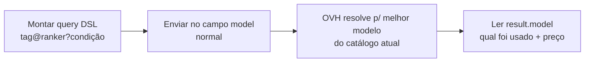

**Explicação.** Em vez de fixar `"model": "X"`, você declara **o que precisa** e a OVH resolve para o melhor modelo disponível **na hora**. Sintaxe em 3 partes:

| Parte | O que é | Valores |
|---|---|---|
| **tag** | série, publicador ou use-case | `llama`, `mistral`, `qwen`, `gpt-oss`, `meta-llama`, `code_chat`, `code_completion`, `summarization`… (ver catálogo) |
| **ranker** | critério de escolha | `fastest`, `cheapest`, `biggest`, `latest`, `smallest` |
| **condição** (opcional) | trava de requisitos | `context_size`, `max_tokens`, `input_cost`, `params`, `endpoint_publication_date` com `<`, `>`, `=` |

**Exemplos de queries:**

| Query | Significado |
|---|---|
| `code_completion@latest` | modelo de autocomplete mais recente (ex.: `Qwen3.6-27B`) |
| `meta-llama@latest` | Llama mais recente (ex.: `Meta-Llama-3_3-70B-Instruct`) |
| `gpt-oss@cheapest` | gpt-oss mais barato (ex.: `gpt-oss-20b`) |
| `mistral@latest?context_size>100000` | Mistral mais recente com +100K ctx |
| `qwen@biggest?input_cost<0.5` | maior Qwen custando < €0.50/Mtok in |

**Código — Python:**

```python
import os
from openai import OpenAI

client = OpenAI(
    base_url="https://oai.endpoints.kepler.ai.cloud.ovh.net/v1",
    api_key=os.getenv("OVH_AI_ENDPOINTS_ACCESS_TOKEN"),
)

result = client.chat.completions.create(
    model="mistral@latest",   # ← DSL em vez de nome fixo
    messages=[{"role": "user", "content": "Explique gravidade para uma criança de 6 anos"}],
    temperature=0, max_tokens=1024,
)
print("Modelo resolvido:", result.model)
print(result.choices[0].message.content)
```

**Código — cURL:**

```bash
curl https://oai.endpoints.kepler.ai.cloud.ovh.net/v1/chat/completions \
  -H "Content-Type: application/json" \
  -H "Authorization: Bearer $OVH_AI_ENDPOINTS_ACCESS_TOKEN" \
  -d '{"model": "qwen@latest?input_cost<0.5",
       "messages": [{"role": "user", "content": "Qual a capital da França?", "reasoning_effort": "none"}],
       "seed": 21, "max_tokens": 20}'
# → {"model": "Qwen3.6-27B", ...}  (a resposta diz qual modelo foi usado!)
```

> ⚠️ Como o modelo pode mudar com o tempo, **trave preço/contexto** na condição se isso importar (`?input_cost<0.5`), e registre `result.model` para auditoria de custo.

---

### Uso 12 — Speech-to-Text (Whisper: diarização, tradução, legendas)

**Micro-etapas:**

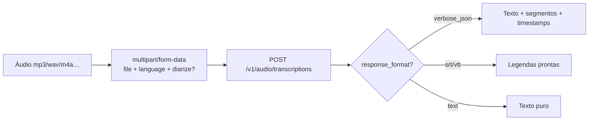

**Explicação.** Modelos `whisper-large-v3` (precisão máxima) e `whisper-large-v3-turbo` (até ~2× mais rápido, mais barato). Suporta **diarização** (quem falou o quê: *Speaker 1/2*), **tradução p/ inglês** via `prompt`, **timestamps por palavra/segmento** e **5 formatos de saída**. Cobrança por **segundo de áudio**. Arquivos longos (>~30s): use `chunking_strategy` (acelera 1.5–2×).

**Parâmetros principais:**

| Parâmetro | Tipo | Efeito |
|---|---|---|
| `file` * | binário | mp3, mp4, aac, m4a, wav, flac, ogg, opus, webm, mpeg, mpga |
| `language` | `pt`, `en`, `fr`… (ISO-639-1) | informa o idioma → mais rápido e preciso |
| `diarize` | bool | `true` = separa Speaker 1/2 (reuniões, entrevistas) |
| `prompt` | string | guia estilo / traduz p/ inglês / continua segmento |
| `response_format` | `verbose_json` (default), `json`, `text`, `srt`, `vtt` | formato da saída |
| `timestamp_granularities` | `["segment"]`, `["word"]`, ambos | granularidade dos tempos |
| `temperature` | 0–1 (default 0) | 0 = determinístico |
| `chunking_strategy` | `auto`/server_vad | segmentação p/ áudios longos |
| `stream` | bool | ainda **não suportado** no Whisper |

**Código — Python (transcrição + diarização + SRT):**

```python
import os
from openai import OpenAI

client = OpenAI(
    base_url="https://oai.endpoints.kepler.ai.cloud.ovh.net/v1",
    api_key=os.environ["OVH_AI_ENDPOINTS_ACCESS_TOKEN"],
)

# 1) Transcrição rica (JSON detalhado + diarização em português)
with open("reuniao.mp3", "rb") as f:
    t = client.audio.transcriptions.create(
        file=f,
        model="whisper-large-v3-turbo",
        language="pt",
        diarize=True,
        timestamp_granularities=["segment"],
        response_format="verbose_json",
        temperature=0,
    )
print(t.text)
for seg in (t.segments or []):
    print(f"[{seg['start']:.1f}s] {seg.get('speaker', '?')}: {seg['text']}")

# 2) Legendas SRT prontas para o player
with open("reuniao.mp3", "rb") as f:
    srt = client.audio.transcriptions.create(
        file=f, model="whisper-large-v3-turbo", language="pt", response_format="srt",
    )
open("reuniao.srt", "w").write(srt)
```

**Código — cURL:**

```bash
curl https://oai.endpoints.kepler.ai.cloud.ovh.net/v1/audio/transcriptions \
  -H "Authorization: Bearer $OVH_AI_ENDPOINTS_ACCESS_TOKEN" \
  -F file="@reuniao.mp3" \
  -F model="whisper-large-v3-turbo" \
  -F language="pt" \
  -F diarize="true" \
  -F response_format="verbose_json"
```

📄 Executável: [`exemplos/python/12_transcribe.py`](../exemplos/python/12_transcribe.py)

---

### Uso 13 — Text-to-Speech (NVIDIA Riva)

**Micro-etapas:**

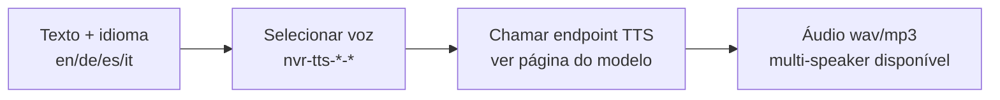

**Explicação.** 4 vozes NVIDIA Riva naturais, **multi-speaker**, atualmente **grátis** no catálogo: `nvr-tts-en-us` (inglês americano), `nvr-tts-de-de` (alemão), `nvr-tts-es-es` (espanhol europeu), `nvr-tts-it-it` (italiano). ⚠️ **Não há voz pt-BR nativa** — para português, avalie gerar com voz EN/ES/IT (sotaque) ou pipeline híbrida. Consulte a **página do modelo no catálogo → aba API** para o schema exato do endpoint (os modelos Riva usam rota própria documentada lá, não o `/v1/audio/speech` genérico).

**Código — padrão (ajuste o schema pela aba API do modelo):**

```bash
# Descubra o schema exato na página do modelo (aba API → TRY gera o cURL).
# Padrão típico dos endpoints Riva no AI Endpoints:
curl -X POST "https://<endpoint-do-modelo-nvr-tts-en-us>" \
  -H "Authorization: Bearer $OVH_AI_ENDPOINTS_ACCESS_TOKEN" \
  -H "Content-Type: application/json" \
  -d '{"text": "Hello, this is a test of the OVHcloud text to speech service.",
       "voice": "default", "format": "wav"}' \
  --output fala.wav
```

**Código — JavaScript (exemplo conceitual, validar schema no catálogo):**

```javascript
// Sempre confirme o payload na aba API da página nvr-tts-* no catálogo.
const res = await fetch("https://<endpoint-do-modelo>", {
  method: "POST",
  headers: {
    "Authorization": `Bearer ${process.env.OVH_AI_ENDPOINTS_ACCESS_TOKEN}`,
    "Content-Type": "application/json",
  },
  body: JSON.stringify({ text: "Hola, esto es una prueba.", voice: "default" }),
});
const buf = Buffer.from(await res.arrayBuffer());
require("fs").writeFileSync("fala.wav", buf);
```

---

### Uso 14 — Geração de imagens (Stable Diffusion XL)

**Micro-etapas:**

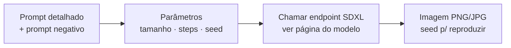

**Explicação.** `stable-diffusion-xl-base-v10` (3.5B params, licença OpenRail++), atualmente **grátis**. Ideal para thumbnails, mockups, placeholders e assets de marketing. O schema exato está na **página do modelo → aba API** (prompt, negative_prompt, width/height, num_inference_steps, seed…).

**Código — padrão (validar schema na aba API):**

```bash
curl -X POST "https://<endpoint-sdxl-do-catalogo>" \
  -H "Authorization: Bearer $OVH_AI_ENDPOINTS_ACCESS_TOKEN" \
  -H "Content-Type: application/json" \
  -d '{"prompt": "modern cozy office with plants, soft daylight, photorealistic",
       "negative_prompt": "blurry, watermark, low quality",
       "width": 1024, "height": 1024, "num_inference_steps": 30, "seed": 42}' \
  --output imagem.png
```

```python
# Python — mesmo padrão via requests (schema exato na aba API do modelo)
import os, requests
resp = requests.post(
    "https://<endpoint-sdxl-do-catalogo>",
    headers={"Authorization": f"Bearer {os.environ['OVH_AI_ENDPOINTS_ACCESS_TOKEN']}"},
    json={"prompt": "modern cozy office with plants, soft daylight, photorealistic",
          "width": 1024, "height": 1024, "num_inference_steps": 30, "seed": 42},
)
open("imagem.png", "wb").write(resp.content)
```

---

### Uso 15 — Moderação / LLM Guard (Qwen3Guard)

**Micro-etapas:**

```mermaid
flowchart LR
    A[Texto entrada ou saída] --> B[Enviar ao Guard<br/>Gen-8B preciso / 0.6B rápido]
    B --> C{Rótulo seguro?}
    C -->|sim| D[Prosseguir pipeline]
    C -->|não| E[Bloquear / revisar<br/>logar incidente]
```

**Explicação.** `Qwen3Guard-Gen-8B` (preciso) e `Qwen3Guard-Gen-0.6B` (rápido/leve), ambos **beta e grátis**, contexto 32K, tag `Moderation`. Use como **porta de entrada** (filtrar prompt do usuário antes do LLM caro) e/ou **porta de saída** (filtrar resposta antes de exibir). Reduz risco e custo. Schema na página do modelo → aba API.

**Padrão de integração (pseudocódigo válido para qualquer SDK):**

```python
def guard_ok(text: str) -> bool:
    # POST no endpoint Qwen3Guard (schema exato na aba API do catálogo)
    verdict = call_guard_endpoint(text)  # ex.: {"safe": True/False, "categories": [...]}
    return verdict.get("safe", False)

user_msg = input("Você: ")
if not guard_ok(user_msg):
    print("⚠️ Mensagem bloqueada pela moderação.")
else:
    answer = llm_chat(user_msg)          # Uso 1
    print("🤖:", answer if guard_ok(answer) else "⚠️ Resposta filtrada.")
```

---

### Uso 16 — Batch API (processamento em massa, −50%, beta)

**Micro-etapas (o ciclo de 4 estágios):**

```mermaid
flowchart LR
    A["1. PREPARAR<br/>requests.jsonl ≤200MB ≤50k linhas"] --> B["2. UPLOAD<br/>POST /v1/files purpose=batch"]
    B --> C["3. CRIAR<br/>POST /v1/batches endpoint + 24/48/72h"]
    C --> D["4. POLL<br/>GET /v1/batches/id até completed"]
    D --> E["5. DOWNLOAD<br/>GET /v1/files/id/content"]
```

**Explicação.** O **Batch** troca latência por preço: você submete **até 50 mil requests num arquivo JSONL** (máx. 200 MB), ele processa em background com SLO de **24h** (janelas 24/48/72h), e você baixa os resultados. **50% do preço do Base** (grátis durante o beta), **até 5 batches simultâneos**, arquivos de saída apagados em **15 dias**. MVP cobre **LLMs + embeddings**; todas as requests de um batch devem mirar o **mesmo endpoint**. Falhas internas/timeout **não são cobradas**. Estados: `validating → in_progress → finalizing → completed` (ou `failed/expired/cancelled`).

**Passo 1 — preparar `requests.jsonl`** (1 objeto por linha, `custom_id` único!):

```jsonl
{"custom_id": "request-1", "method": "POST", "url": "/v1/chat/completions", "body": {"model": "gpt-oss-20b", "messages": [{"role": "user", "content": "Resuma Hamlet em 2 frases."}]}}
{"custom_id": "request-2", "method": "POST", "url": "/v1/chat/completions", "body": {"model": "gpt-oss-20b", "messages": [{"role": "user", "content": "Traduza 'Bom dia' para francês, espanhol e alemão."}]}}
```

**Código — Python (ciclo completo):**

```python
import os, time
from openai import OpenAI

client = OpenAI(
    base_url="https://oai.endpoints.kepler.ai.cloud.ovh.net/v1",
    api_key=os.environ["OVH_AI_ENDPOINTS_ACCESS_TOKEN"],  # Batch EXIGE key (sem anônimo)
)

# 2) Upload
f = client.files.create(file=open("requests.jsonl", "rb"), purpose="batch")
print("file:", f.id)

# 3) Criar batch
batch = client.batches.create(
    input_file_id=f.id,
    endpoint="/v1/chat/completions",
    completion_window="24h",
    metadata={"description": "Rotulagem em massa - out/2026"},
)
print("batch:", batch.id, batch.status)

# 4) Poll até estado terminal
while True:
    cur = client.batches.retrieve(batch.id)
    print(cur.status, cur.request_counts)
    if cur.status in ("completed", "failed", "expired", "cancelled"):
        break
    time.sleep(30)

# 5) Download
final = client.batches.retrieve(batch.id)
if final.output_file_id:
    out = client.files.content(final.output_file_id)
    open("results.jsonl", "wb").write(out.read())
if final.error_file_id:
    err = client.files.content(final.error_file_id)
    open("errors.jsonl", "wb").write(err.read())
print("OK! results.jsonl + errors.jsonl")
```

**Código — cURL (mesmo ciclo):**

```bash
# Upload
curl https://oai.endpoints.kepler.ai.cloud.ovh.net/v1/files \
  -H "Authorization: Bearer $OVH_AI_ENDPOINTS_ACCESS_TOKEN" \
  -F purpose="batch" -F file="@requests.jsonl"
# → {"id": "file-abc123", ...}

# Criar
curl https://oai.endpoints.kepler.ai.cloud.ovh.net/v1/batches \
  -H "Authorization: Bearer $OVH_AI_ENDPOINTS_ACCESS_TOKEN" \
  -H "Content-Type: application/json" \
  -d '{"input_file_id": "file-abc123", "endpoint": "/v1/chat/completions",
       "completion_window": "24h", "metadata": {"description": "Rotulagem em massa"}}'

# Poll
curl https://oai.endpoints.kepler.ai.cloud.ovh.net/v1/batches/batch_abc123 \
  -H "Authorization: Bearer $OVH_AI_ENDPOINTS_ACCESS_TOKEN"

# Download
curl https://oai.endpoints.kepler.ai.cloud.ovh.net/v1/files/file-xyz789/content \
  -H "Authorization: Bearer $OVH_AI_ENDPOINTS_ACCESS_TOKEN" -o results.jsonl

# Listar / cancelar
curl "https://oai.endpoints.kepler.ai.cloud.ovh.net/v1/batches?limit=20" \
  -H "Authorization: Bearer $OVH_AI_ENDPOINTS_ACCESS_TOKEN"
curl -X POST https://oai.endpoints.kepler.ai.cloud.ovh.net/v1/batches/batch_abc123/cancel \
  -H "Authorization: Bearer $OVH_AI_ENDPOINTS_ACCESS_TOKEN"
```

**Formato da saída** (`results.jsonl`): cada linha ecoa seu `custom_id` + `response.body` **idêntico ao que a rota síncrona retornaria** (reutilize o mesmo parser!). ⚠️ **A ordem NÃO é garantida** — correlacione por `custom_id`.

**Quando usar Base × Batch:**

| Critério | Base (tempo real) | Batch (async) |
|---|---|---|
| Latência | imediata | até 24h (SLO) |
| Preço | cheio | **−50%** |
| Volume | 1 prompt/chamada (1–25 emb.) | 50k/chamada, 200 MB |
| Rate limit | 400 req/min | n/a (5 simultâneos) |
| SLA | 99,98% | sem SLA no beta |
| Casos | chat, agentes, IDE | rotulagem, avaliação, ETL de texto, geração em massa |

📄 Executável: [`exemplos/python/16_batch.py`](../exemplos/python/16_batch.py)

---

### Uso 17 — Catalog API (descoberta programática de modelos)

**Micro-etapas:**

```mermaid
flowchart LR
    A[GET catalog…/models_v2<br/>sem auth!] --> B[Array JSON c/ tudo]
    B --> C[Filtrar localmente<br/>categoria · tags · input_modality]
    C --> D[Buscar por id<br/>+ checar available]
```

**Explicação.** A Catalog API retorna **o catálogo inteiro num único GET, sem autenticação**. Ideal para: popular seletores de modelo, validar `model` antes de chamar, rotear (ex.: só modelos `vision`), monitorar novos modelos. ⚠️ Filtre **do seu lado** (não há query params) e cheque `available: true` (alguns listados estão indisponíveis).

**Código — Python:**

```python
import requests

catalog = requests.get("https://catalog.endpoints.ai.ovh.net/rest/v1/models_v2").json()

# Só modelos que aceitam imagem
vision = [m for m in catalog
          if "image" in m["metadata"]["model_specs"]["capabilities"]["input_modality"]]
print("vision:", [m["id"] for m in vision])

# Detalhe de um modelo
m = next(m for m in catalog if m["id"] == "gpt-oss-20b")
print(m["id"], "| categoria:", m["category"], "| disponível:", m["available"])
print("tags:", m["metadata"].get("tags"))
```

**Código — JavaScript:**

```javascript
const catalog = await (await fetch("https://catalog.endpoints.ai.ovh.net/rest/v1/models_v2")).json();
const vision = catalog.filter((m) =>
  m.metadata.model_specs.capabilities.input_modality.includes("image"));
console.log("vision:", vision.map((m) => m.id));
console.log("total:", catalog.length);
```

📄 Executável: [`exemplos/python/17_catalog.py`](../exemplos/python/17_catalog.py)

---

### Uso 18 — Integrações com frameworks e plataformas

**Micro-etapas (padrão universal):**

```mermaid
flowchart LR
    A[Instalar SDK do framework] --> B["Apontar p/ OVH<br/>baseURL + apiKey + model"]
    B --> C[Usar API nativa do framework<br/>zero código OVH-específico]
```

**Explicação.** Todas as integrações seguem o mesmo truque: **trocar o provider/baseURL**. A OVH mantém páginas oficiais para cada uma (links abaixo). Escolha pelo seu stack:

| Integração | Tipo | Instalação / config | Doc oficial |
|---|---|---|---|
| **OpenAI SDK** (Python/JS) | base de tudo | `pip install openai` + `base_url` OVH | docs OVH |
| **Hugging Face** (Inference Providers) | hub + router | `InferenceClient` + `model="openai/gpt-oss-120b:ovhcloud"` | `huggingface.co/docs/inference-providers/.../ovhcloud` |
| **LiteLLM** | gateway 100+ LLMs | `model="ovhcloud/<id>"` | `docs.litellm.ai/docs/providers/ovhcloud` |
| **LangChain** (Python/JS) | agentes/RAG | `ChatMistralAI(endpoint=OVH)` / `OVHCloudEmbeddings` | guias OVH (RAG, memória) |
| **LlamaIndex** (Python/TS) | RAG/agentes | `pip install llama-index-llms-ovhcloud` | `developers.llamaindex.ai/.../ovhcloud` |
| **Pydantic AI** | agentes tipados | provider `openai` c/ baseURL OVH | `ai.pydantic.dev/models/openai/#ovhcloud` |
| **Pydantic AI Gateway** | 1 key, N modelos, budget | gateway config | `ai.pydantic.dev/gateway` |
| **Continue** | IDE assistant | `config.yaml` (Uso 4) | `docs.continue.dev/.../ovhcloud` |
| **Kilo Code (+CLI)** | coding agent | provider ovhcloud | `kilo.ai/docs/providers/ovhcloud` |
| **OpenCode** | agent no terminal | `/connect` OVH | `opencode.ai/docs/providers/#ovhcloud` |
| **SHAI by OVHcloud** | assistente shell OVH | GitHub `ovh/shai` | `github.com/ovh/shai` |
| **Copilot Chat** (extensão) | VS Code | `ovhcloud-ai-endpoints-copilot` | `github.com/mikecastrodemaria/...` |
| **Mastra** | agentes TypeScript | provider ovhcloud | `mastra.ai/models/providers/ovhcloud` |
| **LiveKit** | agentes voz/vídeo | plugin ovhcloud | `docs.livekit.io/agents/models/llm/plugins/ovhcloud` |
| **Apache Airflow** | workflows | `apache-airflow-provider-ovhcloud-ai` | `ovh.github.io/apache-airflow-provider-ovhcloud-ai` |
| **Docker Agent** | agentes em YAML | provider ovhcloud | `docker.github.io/docker-agent/providers/ovhcloud` |
| **Strands Agents** | agentes AWS-open | `OpenAIModel(base_url=OVH)` | `strandsagents.com/.../ovhcloud-ai-endpoints` |

**Código — LiteLLM (Python):**

```python
# pip install litellm
import litellm, os
os.environ["OVHCLOUD_API_KEY"] = os.environ["OVH_AI_ENDPOINTS_ACCESS_TOKEN"]

# Chat (qualquer modelo do catálogo via prefixo ovhcloud/)
r = litellm.completion(
    model="ovhcloud/Meta-Llama-3_3-70B-Instruct",
    messages=[{"role": "user", "content": "Olá!"}],
)
print(r.choices[0].message.content)

# Embeddings + transcrição também funcionam
from litellm import embedding, transcription
print(embedding(model="ovhcloud/BGE-M3", input=["texto exemplo"]).data)
print(transcription(model="ovhcloud/whisper-large-v3-turbo",
                    file=open("audio.wav", "rb")).text)
```

**Código — Hugging Face (`huggingface_hub`):**

```python
# pip install huggingface_hub
import os
from huggingface_hub import InferenceClient

client = InferenceClient(api_key=os.environ["HF_TOKEN"])  # roteia via HF…
# …ou use sua key OVH diretamente
resp = client.chat.completions.create(
    model="openai/gpt-oss-120b:ovhcloud",   # ← sufixo :ovhcloud escolhe o provider
    messages=[{"role": "user", "content": "Qual a capital da França?"}],
)
print(resp.choices[0].message.content)
```

**Código — LlamaIndex (Python):**

```python
# pip install llama-index-llms-ovhcloud
from llama_index.llms.ovhcloud import OVHcloud

llm = OVHcloud(model="Meta-Llama-3_3-70B-Instruct",
               api_key="SUA_KEY")  # "" = free tier c/ rate limit
print(llm.complete("Olá, mundo!"))
print([m.id for m in llm.available_models])  # descoberta dinâmica!
```

**Código — LlamaIndex (TypeScript):**

```typescript
// npm i llamaindex @llamaindex/ovhcloud
import { OVHcloudLLM } from "@llamaindex/ovhcloud";
import { Settings } from "llamaindex";
Settings.llm = new OVHcloudLLM({
  model: "gpt-oss-120b",
  apiKey: process.env.OVHCLOUD_API_KEY || "",
});
```

---

## PARTE 5 — Limites, preços, SLA, segurança e ciclo de vida

### 5.1. Limites técnicos (tabela-mestre)

| Limite | Anônimo | Autenticado (API key) |
|---|---|---|
| Taxa | **2 req/min** por IP **e** por modelo | **400 req/min** por projeto **e** por modelo |
| Payload | 2 MB (texto/JSON) · **10 MB** (VLM) · áudio: limite por duração/tamanho do Whisper | idem |
| Base: prompts/chamada | 1 (1–25 p/ embeddings) | idem |
| Batch: tamanho | ❌ exige key | 200 MB / 50k linhas / 5 simultâneos |
| Playground LLM | 1024 tokens de saída (teste) | idem |
| Excesso | `429 Too Many Requests` | `429` — [contate suporte](https://help.ovhcloud.com/csm?id=csm_get_help) p/ ampliar |

### 5.2. Preços (modelo mental + exemplos 10/2026)

- **LLM/VLM/Reasoning:** € por **milhão de tokens**, separado **input/output** (output custa mais).
- **Embeddings:** € por Mtok de **input**.
- **STT:** € por **segundo de áudio** (`turbo` ≈ 3× mais barato que `v3`).
- **TTS / Imagem / Guard:** **€0** no catálogo atual.
- **Batch:** **50% do Base** (grátis no beta); falhas internas não cobradas.

Exemplos: `gpt-oss-20b` €0.04/0.15 · `Qwen3.5-9B` €0.10/0.15 · `Llama-3.3-70B` €0.67/0.67 · `Qwen3.8-27B` €0.40/2.70 · `bge-m3` €0.01 · `whisper-turbo` €0.00001278/s. Ver todos em [`CATALOGO-MODELOS.md`](CATALOGO-MODELOS.md) e preços oficiais em `public-cloud/prices/#ai-endpoints`.

### 5.3. SLA e modos

| | Base (GA) | Batch (beta) |
|---|---|---|
| SLA | **99,98%** (página produto) / 99,5% (docs API) | sem SLA no beta |
| SLO resposta | tempo real | 24h (janelas 24/48/72h) |

### 5.4. Segurança, soberania e privacidade

- **Hospedado na UE** (Gravelines, FR) · **Zero data retention** (só o necessário p/ billing) · **nunca treina** com seus dados.
- Certificações: **ISO 27001, SOC 2 Tipo II, HDS** (dados de saúde).
- Keys com **expiração**, revogação imediata; rode keys por ambiente; nunca exponha no frontend (use backend proxy).
- Termos: *OVHcloud Public Cloud Special Conditions*, Apêndice 10 (AI Endpoints).

### 5.5. Ciclo de vida dos modelos

A OVH versiona modelos com transparência (guia *Billing and lifecycle*). Modelos podem ser **atualizados/substituídos** — estratégias: (a) fixe o `model` exato e monitore o changelog/roadmap; (b) use **Virtual Models** (Uso 11) para flutuar com trava de custo/contexto; (c) liste periodicamente via **Catalog API** (Uso 17) e alerte se `available=false`.

---

## PARTE 6 — Árvore de decisão: qual modelo / rota / modo usar?

```mermaid
flowchart TD
    Q1{Resposta imediata?} -->|Não, é massa| BATCH[📦 BATCH · Uso 16<br/>JSONL + /v1/batches · −50%]
    Q1 -->|Sim| Q2{Que dado entra?}
    Q2 -->|Só texto| Q3{Precisa raciocinar<br/>forte?}
    Q3 -->|Sim| R[gpt-oss-120b / Qwen3 · Uso 2]
    Q3 -->|Não| Q4{Precisa agir<br/>chamar funções?}
    Q4 -->|Sim| T[Modelo function_calling + tools · Uso 7]
    Q4 -->|Não| Q5{Saída precisa ser<br/>JSON exato?}
    Q5 -->|Sim| J[json_schema · Uso 8]
    Q5 -->|Não| C[LLM barato: gpt-oss-20b · Uso 1<br/>+ stream se for chat · Uso 9]
    Q2 -->|Texto + imagem| V[Qwen3.8/3.6-27B · Uso 3]
    Q2 -->|Código no IDE| IDE[Continue/Copilot + Qwen · Uso 4]
    Q2 -->|Meus documentos| RAG[bge-m3 + LLM · Uso 6]
    Q2 -->|Áudio| STT[whisper-turbo · Uso 12]
    Q2 -->|Quero fala| TTS[nvr-tts-* · Uso 13]
    Q2 -->|Quero imagem| IMG[SDXL · Uso 14]
    Q2 -->|Filtrar conteúdo| G[Qwen Guard · Uso 15]
```

**Regra de ouro do custo:** comece pelo **mais barato que resolve** (`gpt-oss-20b`, `Qwen3.5-9B`, `bge-m3`, `whisper-turbo`), meça qualidade, só então suba. E se não precisa de tempo real, **Batch corta metade da conta**.

---

## PARTE 7 — Troubleshooting (erros comuns)

| Sintoma | Causa provável | Solução |
|---|---|---|
| `403 Forbidden: Authentication Failed` | key errada/revogada/expirada ou projeto Discovery sem pagamento | gere nova key; confira pagamento no projeto |
| `429 Too Many Requests` | estourou 2/min (anônimo) ou 400/min (key) | adicione key; implemente backoff+jitter; peça ampliação |
| `413 / payload too large` | >2 MB (ou >10 MB VLM) | comprima imagem, fatie texto, use Batch |
| Resposta cortada no Playground | limite 1024 tokens de saída no playground | é só no playground — via API use `max_tokens` |
| `model not found` | id errado ou modelo indisponível | `GET /v1/models` ou Catalog API; cheque `available` |
| Batch `failed` | JSONL malformado / `custom_id` duplicado / endpoints misturados | valide JSONL (1 obj/linha, ids únicos, mesmo endpoint) |
| Batch `expired` | não coube na janela | use 48h/72h ou fatie em batches menores |
| STT lento/impreciso | idioma não informado, áudio longo sem chunking | passe `language`, ative `chunking_strategy` |
| `stream` não funciona no STT | Whisper não suporta stream | use chamada síncrona |
| Código vaza p/ cloud pública | plugin apontando p/ API errada | confira `baseURL` = `...kepler.ai.cloud.ovh.net/v1` |
| Custo inesperado | modelo `latest`/virtual resolveu p/ modelo caro | trave `?input_cost<…`, logue `result.model` |

**Retry com backoff (Python, recomendado em produção):**

```python
import random, time
from openai import RateLimitError, APIConnectionError

def with_retry(fn, tries=5):
    for i in range(tries):
        try:
            return fn()
        except (RateLimitError, APIConnectionError) as e:
            if i == tries - 1:
                raise
            time.sleep((2 ** i) + random.random())  # backoff exponencial + jitter
```

---

## PARTE 8 — Produtos irmãos (quando NÃO usar AI Endpoints)

| Produto | O que é | Use quando… |
|---|---|---|
| **AI Deploy** | deploy dos **seus** modelos/apps como API | precisa de modelo próprio/customizado em produção |
| **Cloud GPU** | VMs com GPU (até 1000× CPU p/ paralelo) | quer rodar/inferir você mesmo, fine-tuning |
| **AI Training** | treino distribuído gerenciado | precisa treinar/fine-tunar modelos |
| **AI Notebooks** | Jupyter gerenciado c/ GPU | experimentação, protótipos, cursos |
| **Data Platform** | dados & analytics centralizado | pipeline de dados antes/depois da IA |
| **Quantum Platform** | emuladores quânticos | pesquisa quântica (outro universo 🙂) |

Regra prática: **AI Endpoints** = "quero IA pronta via API, sem infra". Qualquer necessidade de **modelo próprio, treino ou controle de GPU** → irmãos acima.

---

## Anexos — Exemplos executáveis neste repositório

| Arquivo | Uso | Descrição |
|---|---|---|
| [`exemplos/python/01_chat.py`](../exemplos/python/01_chat.py) | 1 | chat mínimo + contagem de tokens |
| [`exemplos/python/03_vision.py`](../exemplos/python/03_vision.py) | 3 | OCR/descrição de imagem local |
| [`exemplos/python/05_embeddings.py`](../exemplos/python/05_embeddings.py) | 5 | vetorizar textos c/ bge-m3 |
| [`exemplos/python/07_tools.py`](../exemplos/python/07_tools.py) | 7 | tool calling clima (loop agente) |
| [`exemplos/python/09_stream.py`](../exemplos/python/09_stream.py) | 9 | streaming token-a-token |
| [`exemplos/python/12_transcribe.py`](../exemplos/python/12_transcribe.py) | 12 | transcrição + diarização + SRT |
| [`exemplos/python/16_batch.py`](../exemplos/python/16_batch.py) | 16 | ciclo batch completo |
| [`exemplos/python/17_catalog.py`](../exemplos/python/17_catalog.py) | 17 | listar/filtrar catálogo |
| [`exemplos/javascript/01_chat.mjs`](../exemplos/javascript/01_chat.mjs) | 1 | chat em Node |
| [`exemplos/curl/01_chat.sh`](../exemplos/curl/01_chat.sh) | 1 | chat em cURL |
| [`exemplos/curl/12_transcribe.sh`](../exemplos/curl/12_transcribe.sh) | 12 | STT em cURL |

Todos leem a key de `OVH_AI_ENDPOINTS_ACCESS_TOKEN`. Rode: `pip install openai requests` (Python) ou `npm install openai` (JS).

---

*Fim do guia. Dúvidas/comunidade: canal `#ai-endpoints` no [Discord OVHcloud](https://discord.gg/ovhcloud) · Roadmap público no GitHub (link no topo).*
